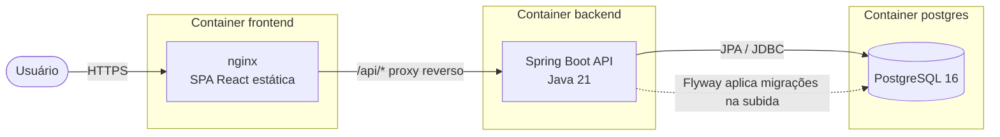
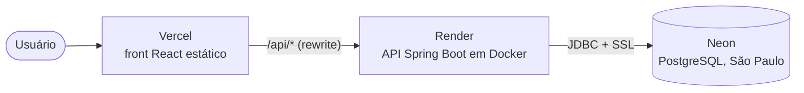
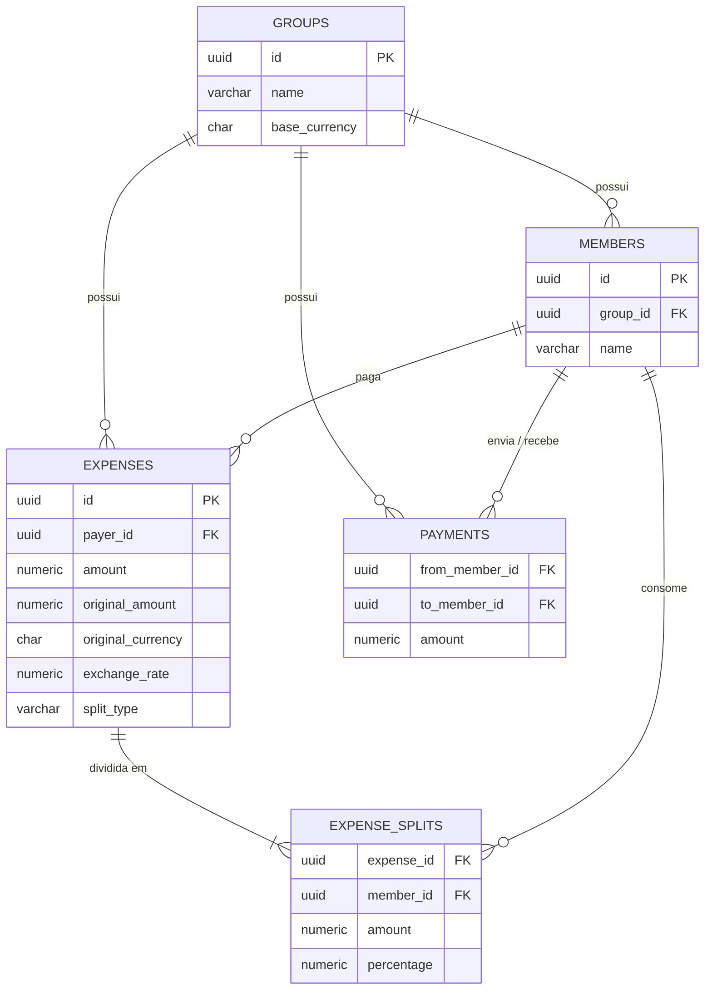

# Split&Go

Plataforma de gestão e rateio inteligente de despesas em grupo (viagens, repúblicas, eventos): lance os gastos, divida de forma igual, por porcentagem ou por valor fixo, e descubra **quem paga quem com o menor número de transferências**.

- 📋 **Board do projeto:** https://github.com/users/muryllovieira/projects/1
- 🌐 **Aplicação online:** https://split-go-delta.vercel.app
  - API: https://split-go-api.onrender.com/actuator/health — plano gratuito: após 15 min sem uso, a primeira requisição pode levar ~50 s para "acordar" o servidor.

## Sumário

- [Funcionalidades](#funcionalidades)
- [Stack](#stack)
- [Como rodar localmente](#como-rodar-localmente)
- [Arquitetura e Infraestrutura](#arquitetura-e-infraestrutura)
- [Modelo de dados](#modelo-de-dados)
- [Algoritmo de simplificação de saldos](#algoritmo-de-simplificação-de-saldos)
- [Edge cases](#edge-cases)
- [Proposta de evolução (V2)](#proposta-de-evolução-v2)
- [API](#api)
- [Testes](#testes)
- [Gestão do projeto](#gestão-do-projeto)

## Funcionalidades

| Requisito do case | Como foi atendido |
| --- | --- |
| Cadastro de grupos e integrantes | Grupo nasce com ao menos 2 integrantes; adicionar/remover depois; link compartilhável |
| Despesas flexíveis | 1 pagador, N participantes; divisão **igual**, por **porcentagem** ou por **valor fixo** |
| Simplificação de saldos | Algoritmo que gera o plano com o mínimo de transferências (ex.: A→B→C vira A→C) |
| Painel de quitação | Plano de liquidação, extrato individual detalhado e "marcar como pago" |

**Sem login no MVP:** o grupo é acessado pelo link (`/groups/{uuid}`). O UUID não é sequencial, então não dá para "adivinhar" grupos de outras pessoas. Grupos visitados ficam salvos em "Seus grupos recentes" (localStorage).

## Stack

| Camada | Tecnologia | Por quê |
| --- | --- | --- |
| Frontend | React 19 + TypeScript (Vite), Tailwind CSS 4 | Tipos espelhando os DTOs da API pegam quebras de contrato em tempo de compilação |
| Estado de servidor | TanStack Query | Cache, loading/erro e revalidação sem `useEffect` manual |
| Rotas | React Router 8 | O link do grupo é a própria URL |
| Backend | Java 21 + Spring Boot 4 | Ecossistema maduro, validação declarativa, transações |
| Banco de dados | PostgreSQL 16 | Dinheiro exige consistência (ACID) e o domínio é relacional |
| Migrações | Flyway | Schema versionado; o Hibernate só **valida** (`ddl-auto: validate`) |
| Infra local | Docker Compose | Sobe banco, API e front com um comando |
| Testes | JUnit 5 + AssertJ | Regras de cálculo testadas isoladamente |

## Como rodar localmente

### Com Docker (recomendado)

Pré-requisito: [Docker](https://www.docker.com/) instalado.

```bash
docker compose up -d --build --wait
```

| Serviço | URL |
| --- | --- |
| Frontend | http://localhost:3000 |
| API | http://localhost:8080 |
| Health check | http://localhost:8080/actuator/health |

### Em modo desenvolvimento

Pré-requisitos: Java 21 e Node 24.

```bash
# Banco
docker compose up -d postgres

# Backend (http://localhost:8080)
cd backend && ./mvnw spring-boot:run

# Frontend (http://localhost:5173) — chamadas /api são redirecionadas ao backend
cd frontend && npm install && npm run dev
```

## Arquitetura e Infraestrutura



**Decisões principais**

- **Mesma origem para front e API.** O nginx serve o build do React e repassa `/api/*` para o backend (em dev, o Vite faz o mesmo papel). Resultado: **não é preciso CORS** e o front não precisa saber a URL da API.
- **Sem fila/mensageria no MVP.** Todas as operações são síncronas e rápidas; uma fila só se justifica com processamento assíncrono (ex.: notificações de cobrança — ver [V2](#proposta-de-evolução-v2)).
- **Saldos não são armazenados, são calculados.** São dados derivados das despesas e pagamentos; guardá-los criaria risco de inconsistência a cada edição. O cálculo é uma única consulta agregada por grupo.
- **Configuração por variáveis de ambiente** (`DB_URL`, `DB_USERNAME`, `DB_PASSWORD`, `PORT`), com padrões para rodar local. O mesmo artefato roda em qualquer ambiente.
- **Imagens Docker multi-stage:** o backend compila com JDK e roda só com JRE, com usuário sem privilégio de root; o front gera o build com Node e é servido pelo nginx.

**Deploy atual (produção):**



- **Vercel** serve o build do React e, pelo `vercel.json`, repassa `/api/*` para a API (mesmo papel do nginx no Docker: mesma origem, sem CORS) e devolve o `index.html` nas demais rotas, para o link do grupo abrir direto.
- **Render** constrói a imagem a partir do `backend/Dockerfile`; a configuração vem de variáveis de ambiente (`DB_URL`, `DB_USERNAME`, `DB_PASSWORD`, `PORT`) e o deploy só é concluído quando `/actuator/health` responde `UP`.
- **Neon** hospeda o PostgreSQL; o Flyway cria o schema automaticamente na primeira subida da API.
- Todos com camada gratuita e deploy automático a cada merge na `main`.

### Organização do código

**Backend — por funcionalidade (package-by-feature):**

```
com.splitgo.api
├── group/        Grupo: entidade, repository, service, controller, DTOs
├── member/       Integrantes
├── expense/      Despesas + SplitCalculator (cálculo das fatias)
├── payment/      Pagamentos registrados
├── settlement/   Saldos + DebtSimplifier (algoritmo de quitação)
└── shared/       Exceções de domínio e tratamento global de erros
```

Tudo de uma funcionalidade fica junto. Controllers só recebem HTTP e repassam; regras ficam nos services; o cálculo (`SplitCalculator`, `DebtSimplifier`) fica em classes **puras**, sem banco nem Spring, testadas isoladamente. Erros saem no formato padrão [RFC 9457 (Problem Details)](https://www.rfc-editor.org/rfc/rfc9457): `400` para requisição malformada, `404` para recurso inexistente, `409` para conflito (nome duplicado) e `422` para regra de negócio violada.

**Frontend — Atomic Design:**

```
src/
├── components/
│   ├── atoms/        Button, Input, Money, Avatar...       (só visual)
│   ├── molecules/    FormField, TransferItem, Tabs...      (combinações com uma função)
│   ├── organisms/    ExpenseForm, SettlementPanel...       (seções completas, recebem tudo por props)
│   └── templates/    MainTemplate                          (estrutura da página)
├── pages/            ligam os hooks de dados aos organismos
├── hooks/            useGroup, useExpenses, useSettlement... (TanStack Query)
├── api/              cliente HTTP + tipos espelhando os DTOs
└── lib/              formatação de moeda/data, extrato
```

Componentes visuais **não chamam a API**: os dados vêm dos hooks, conectados nas páginas. O cliente HTTP converte qualquer erro da API (`ProblemDetail.detail`) em uma mensagem pronta para exibir.

## Modelo de dados



- **Dinheiro em `NUMERIC(19,2)` no banco e `BigDecimal` no Java** — nunca `double` (`0.1 + 0.2 ≠ 0.3`).
- **Cada fatia é gravada já calculada** (`expense_splits.amount`). O tipo de divisão só importa no lançamento; depois disso, toda despesa vira "fulano consumiu X", e o saldo é calculado igual para os três tipos.
- **Integridade garantida no banco:** `CHECK`s de valores positivos e de pagamento para si mesmo, índice único para nome de integrante (sem diferenciar maiúsculas), e FKs que impedem apagar um integrante com lançamentos.

## Algoritmo de simplificação de saldos

**1. Saldo líquido de cada integrante**

```
saldo = Σ pagou − Σ consumiu + Σ pagamentos enviados − Σ pagamentos recebidos
```

Positivo = tem a receber; negativo = deve. A soma dos saldos do grupo é **sempre zero** (o algoritmo valida isso e falha se não for, pois indicaria um bug).

**2. Plano de quitação (`DebtSimplifier`)**

1. Separa devedores e credores (quem tem saldo zero é ignorado).
2. **Quita pares exatos primeiro:** um devedor de R$ 50 e um credor de R$ 50 se resolvem com uma única transferência.
3. **Guloso:** com duas filas de prioridade (`PriorityQueue`), emparelha sempre o **maior devedor** com o **maior credor**. O valor transferido é o menor dos dois; quem zera sai, quem sobra volta para a fila com o restante.

Cada transferência zera pelo menos uma pessoa, então são **no máximo N − 1 transferências**. Empates são desfeitos por id, o que torna o plano **determinístico** (mesmos dados → mesmo plano).

**Exemplo do case:** A deve 50 para B e B deve 50 para C → saldos A = −50, B = 0, C = +50 → plano: **A paga 50 para C**.

**Sobre o "mínimo":** encontrar o número mínimo absoluto de transferências é um problema **NP-difícil** (equivale a particionar o grupo no maior número de subconjuntos de soma zero). Foi escolhida uma heurística polinomial — O(n²) no pior caso por causa da busca de pares exatos, e O(n log n) na etapa gulosa — em vez de uma busca exponencial. Para grupos do tamanho real (dezenas de pessoas), o cálculo é instantâneo. Em uma simulação com 20 mil grupos aleatórios, o guloso puro não atingiu o mínimo em 5,5% dos casos; com a etapa de **pares exatos**, esse número caiu para **1,7%**.

## Edge cases

| # | Cenário | Como a aplicação trata |
| --- | --- | --- |
| 1 | **Centavos que não dividem** — R$ 100,00 entre 3 | Cada parte é arredondada para baixo (33,33) e a sobra (0,01) vai para o primeiro participante: **33,34 + 33,33 + 33,33 = 100,00**. A soma das fatias é sempre exatamente o total. |
| 2 | **Porcentagens com arredondamento** — R$ 10,00 em 33,33% / 33,33% / 33,34% | **Método do maior resto:** os centavos que sobram vão para quem mais perdeu no arredondamento (3,334 → Carla fica com 3,34). Mais justo que dar a sobra sempre ao primeiro. |
| 3 | **Valor muito pequeno** — R$ 0,02 entre 3 | Resulta em 0,01 / 0,01 / 0,00. O banco aceita fatia zero (`CHECK amount >= 0`) e a soma continua correta. |
| 4 | **Porcentagens que não somam 100%** ou **valores fixos que não somam o total** | Recusado com `422` e mensagem clara. O formulário também mostra em tempo real "faltam 10%" / "passou R$ 5,00". |
| 5 | **Valores com mais de 2 casas decimais** (ex.: 10,005) | Recusado com `400` antes de qualquer cálculo (`@Digits(fraction = 2)`), evitando arredondamentos silenciosos. |
| 6 | **Comparação de dinheiro** — `new BigDecimal("0")` vs `"0.00"` | Toda comparação usa `compareTo`/`signum`, nunca `equals` (que considera a escala e diria que são diferentes). |
| 7 | **Moeda inválida** (ex.: `XYZ`) | Validada contra a ISO 4217 (`java.util.Currency`) → `422`. Valores são exibidos no formato de cada moeda (`Intl.NumberFormat`). |
| 8 | **Pagamento maior que a dívida** — Carla paga R$ 150 a Ana, que só tem R$ 100 a receber | Recusado com `422`. Um pagamento só é aceito se **reduz** dívidas: quem paga precisa estar devendo, quem recebe precisa ter a receber, e o valor não pode exceder nenhum dos dois. Assim um pagamento nunca cria uma dívida nova. |
| 9 | **Remover integrante que tem lançamentos** | Bloqueado com `422`: apagá-lo distorceria o histórico e os saldos dos outros. Reforçado por FK no banco. |
| 10 | **Grupo com menos de 2 integrantes** | O grupo já é criado com no mínimo 2, e a remoção é bloqueada se deixaria o grupo com menos de 2. |
| 11 | **Integrante de outro grupo** usado como pagador, participante ou em pagamento | Recusado com `422`; todas as buscas filtram por id **e** grupo, então o link de um grupo não acessa dados de outro. |

## Proposta de evolução (V2)

**1. Contas de usuário + cobrança automática** — login (e-mail/Google), um mesmo usuário em vários grupos e **lembretes automáticos** para quem está devendo (e-mail/WhatsApp), processados de forma assíncrona por uma **fila** (ex.: RabbitMQ/SQS).
*Impacto:* aumenta a taxa de quitação dos grupos — o principal valor percebido do produto — e cria base de usuários identificados para retenção e métricas (DAU, grupos ativos por usuário).

**2. Pagamento integrado via Pix** — o botão "Marcar como pago" vira "Pagar com Pix": QR Code com o valor exato da transferência sugerida e baixa automática quando o pagamento é confirmado (webhook do PSP).
*Impacto:* elimina a etapa manual (e o "esqueci de marcar"), reduz atrito e abre uma **fonte de receita** (taxa por transação ou parceria com instituição de pagamento).

**3. Multi-moeda com cotação automática** — lançar despesas na moeda local da viagem com conversão automática para a moeda do grupo, usando uma API de câmbio (ex.: Frankfurter, com dados do Banco Central Europeu).
- **Cotação congelada por despesa (snapshot):** a cotação é buscada **uma única vez, no lançamento**, usando a **data da despesa** (a API aceita datas passadas, então uma despesa lançada dias depois usa o câmbio do dia em que aconteceu). Variações futuras do câmbio **não alteram** despesas antigas, senão os saldos mudariam sozinhos e o grupo nunca fecharia a conta.
- **Cache** por moeda e data: várias despesas em dólar do mesmo dia reutilizam a mesma consulta.
- **Fallback manual:** se a API estiver indisponível, o usuário informa a cotação e o lançamento não é bloqueado.
- **Transparência na tela:** "US$ 60,00 × 5,50 = R$ 330,00".

O schema **já está preparado**: cada despesa guarda `original_amount`, `original_currency` e `exchange_rate`, e o saldo é calculado sobre o valor convertido (`amount`). No MVP, toda despesa é lançada na moeda do grupo (cotação 1).
*Impacto:* atende o público de viagens internacionais, segmento com tíquete e frequência de uso maiores, e diferencia o produto de uma simples planilha.

## API

| Método | Rota | Descrição |
| --- | --- | --- |
| `POST` | `/api/groups` | Cria grupo com integrantes iniciais |
| `GET` | `/api/groups/{id}` | Detalhes do grupo |
| `GET` / `POST` | `/api/groups/{id}/members` | Lista / adiciona integrante |
| `DELETE` | `/api/groups/{id}/members/{memberId}` | Remove integrante (se não tiver lançamentos) |
| `GET` / `POST` | `/api/groups/{id}/expenses` | Lista / lança despesa |
| `GET` | `/api/groups/{id}/expenses/{expenseId}` | Detalhes da despesa |
| `GET` | `/api/groups/{id}/settlement` | Saldos, extrato e plano de quitação |
| `GET` / `POST` | `/api/groups/{id}/payments` | Lista / registra pagamento |

Exemplo — lançar despesa por porcentagem:

```json
POST /api/groups/{id}/expenses
{
  "description": "Passeio",
  "payerId": "uuid-do-bruno",
  "amount": 330.00,
  "splitType": "PERCENTAGE",
  "participants": [
    { "memberId": "uuid-do-bruno", "value": 50 },
    { "memberId": "uuid-da-carla", "value": 50 }
  ]
}
```

## Testes

```bash
cd backend && ./mvnw test -Dtest='SplitCalculatorTest,DebtSimplifierTest'
```

- **`SplitCalculatorTest` (11 testes):** divisão igual, centavos, porcentagem com maior resto, valores fixos e validações.
- **`DebtSimplifierTest` (8 testes):** exemplo A→B→C do case, um devedor para vários credores, pares exatos, centavos, limite de N − 1 transferências e invariante de soma zero — incluindo uma verificação que **aplica** as transferências e confere que todos terminam quites.

## Gestão do projeto

- **Board (GitHub Projects):** https://github.com/users/muryllovieira/projects/1 — histórias de usuário com critérios de aceite, colunas Backlog → In Progress → In Review/Testing → Done.
- **Fluxo:** uma branch por funcionalidade (`feat/...`), Pull Request referenciando as issues (`closes #N`) e merge na `main`.
- **Commits:** [Conventional Commits](https://www.conventionalcommits.org/pt-br/v1.0.0/) (`feat`, `fix`, `refactor`, `chore`, `docs`), cada um ligado à issue correspondente.

```
split-and-go/
├── backend/            API Java + Spring Boot
├── frontend/           React + TypeScript
├── docs/               Documentação
├── scripts/            Scripts utilitários
└── docker-compose.yml
```
